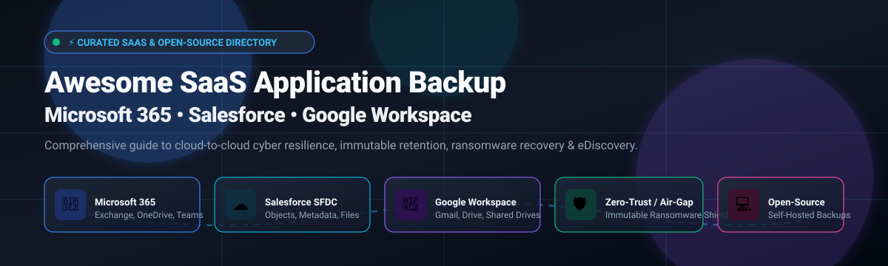
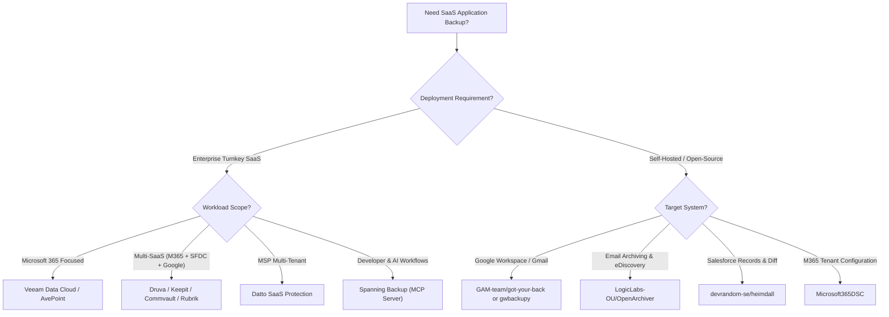

# 🛡️ Awesome SaaS Application Backup (M365, SFDC, Google) ☁️

**A comprehensive, curated directory of top-tier SaaS Application Backup and Cloud-to-Cloud Data Protection solutions for Microsoft 365, Salesforce (SFDC), and Google Workspace — featuring enterprise SaaS platforms and self-hosted open-source alternatives.**

[Explore SaaS Platforms](#-saas--hosted-platforms) • [Explore Open-Source Tools](#-open-source-software) • [Sector Overview](#-sector-overview--market-dynamics) • [Comparison Table](#-comparison-at-a-glance) • [Contributing](#-contributing)

---

## 📑 Table of Contents

- [🌐 Sector Overview & Market Dynamics](#-sector-overview--market-dynamics)
- [🟦 SaaS / Hosted Platforms](#-saas--hosted-platforms)
  - [SaaS Products Comparison Table](#-saas-products-comparison-table)
  - [Detailed SaaS Profiles](#-detailed-saas-profiles)
- [🟩 Open-Source Software](#-open-source-software)
  - [Open-Source Solutions Ranking](#-open-source-solutions-ranked-by-stars)
  - [Detailed Open-Source Profiles](#-detailed-open-source-profiles)
- [📊 Comparison at a Glance](#-comparison-at-a-glance)
- [🎯 Selection Guide & Architecture Patterns](#-selection-guide--architecture-patterns)
- [🤝 Contributing](#-contributing)
- [📄 License](#-license)

---

## 🌐 Sector Overview & Market Dynamics

The global **SaaS Application Backup and Cloud-to-Cloud Data Protection** sector is estimated at **$3.65 billion in 2026** and is projected to expand to **$6.61 billion by 2030 at a ~16.0% CAGR** (with the broader Backup-as-a-Service market exceeding **$20B+**), accelerated by stringent regulatory mandates (such as DORA, NIS2, and HIPAA) and cyber insurance policies demanding immutable, air-gapped offsite recovery.

The sector exhibits **moderate fragmentation transitioning toward an oligopolistic top tier**; while a select cohort of enterprise cybersecurity giants (Rubrik, Veeam, Cohesity, Commvault, and AvePoint) dominates large Fortune 500 contracts and MSP distributor channels, numerous specialized vendors (Druva, Keepit, Rewind, CloudAlly) compete aggressively on specialized cloud-native architectures, API flexibility, and transparent predictable seat-based pricing.

---

## 🟦 SaaS / Hosted Platforms

Enterprise-grade, cloud-hosted SaaS application backup platforms delivering turnkey cloud-to-cloud backup, ransomware defense, immutable retention, and disaster recovery.

### 📋 SaaS Products Comparison Table

> Sorted in descending order by **Company Size / Valuation / Market Cap**.

| Company / Product | Company Size / Valuation 🏢 | Supported Workloads ☁️ | Pricing (Starting Tier) 💵 | Free Tier / Trial Limit ⏱️ | Key Strengths 🌟 |
|:---|:---|:---|:---|:---|:---|
| **[Rubrik SaaS Protection](https://www.rubrik.com)** | **~$22.6B** *(NYSE: RBRK)* | M365, SFDC, Google, Jira, Atlassian | From **$4.50 / user / month** (enterprise tier bundles) | **30-day hosted PoC trial** (limited to 500 users / 10TB data cap) | Zero-trust cyber recovery, AI ransomware anomaly blast-radius detection |
| **[Veeam Data Cloud](https://www.veeam.com)** | **~$15.0B** *(Private valuation)* | M365, Azure, Entra ID | **$2.63 / user / month** (Foundation plan, 251+ seats) | **30-day free trial** (full access for internal evaluation testing) | Enterprise market leader, native Azure-hosted infrastructure, granular eDiscovery |
| **[Cohesity DataProtect SaaS](https://www.cohesity.com)** | **~$7.0B** *(Private valuation)* | M365, SFDC, Exchange, OneDrive | **$200 / TB / year** (~$16.60/TB/mo) or per-user add-on | **30-day free trial** (full-featured cloud BaaS evaluation) | Unified hybrid data security, immutable air-gapped vaults, rapid indexing |
| **[Commvault Cloud SaaS Backup](https://www.commvault.com)** | **~$6.7B** *(NASDAQ: CVLT)* | M365, SFDC, Google Workspace | **$1.70 / user / month** (Standard tier, 5GB storage/seat) | **30-day free trial** (unrestricted cloud SaaS backup evaluation) | Metallic architecture, granular restoration, advanced compliance & eDiscovery |
| **[Datto SaaS Protection](https://www.datto.com)** | **~$6.2B** *(Acquired by Kaseya)* | M365, Google Workspace | **$2.00 / user / month** (via MSP volume tier agreements) | **14-day free trial** (partner/MSP guided evaluation environment) | Built for MSP multi-tenancy, infinite cloud retention, zero storage caps |
| **[CloudAlly](https://www.cloudally.com)** | **~$6.1B** *(Parent: OpenText NASDAQ: OTEX)* | M365, SFDC, Google Workspace, Box | **$2.00 / user / month** (Exchange/SharePoint/OneDrive) | **14-day free trial** (unlimited features, no credit card required) | Budget-friendly pricing, AWS S3/Azure storage choices, 99.999% durability |
| **[AvePoint Cloud Backup](https://www.avepoint.com)** | **~$3.5B** *(NASDAQ: AVPT)* | M365, SFDC, Google Workspace | **$2.50 / user / month** (commercial multi-seat baseline) | **30-day free trial** (full product capabilities & tenant connectors) | Deepest Microsoft 365 ecosystem governance, Teams chat/channel level rollback |
| **[Druva SaaS Backup](https://www.druva.com)** | **~$2.0B** *(Private valuation)* | M365, SFDC, Google Workspace | **$3.50 / user / month** (Business edition, annual billing) | **30-day free trial** (instant self-service setup, no credit card required) | 100% agentless true SaaS, global deduplication, AWS GovCloud isolation |
| **[Spanning Backup](https://www.spanning.com)** | **~$1.5B+** *(Division of Kaseya)* | M365, SFDC, Google Workspace | **$4.00 / user / month** ($48/user/yr starting tier) | **14-day free trial** (complete cloud-to-cloud evaluation) | RESTful administrative APIs, native Model Context Protocol (MCP) server support |
| **[Rewind](https://www.rewind.com)** | **~$150M – $250M** *(Venture / Private)* | QuickBooks, GitHub, Shopify, BigCommerce | **$4.00 / user / month** (Standard SaaS tier; eCommerce from $45/mo) | **7-day free trial** (full features & automated vault backup) | Specialized niche for SaaS tools, developer Git repositories, and eCommerce |
| **[Keepit](https://www.keepit.com)** | **~$150M – $200M** *(Private valuation)* | M365, SFDC, Google, Azure AD | **$2.60 / user / month** (Business Essentials, 3-yr commitment) | **30-day free trial** (unlimited user seats during evaluation window) | Dedicated independent cloud infrastructure, vendor-neutral, blockchain-verified audit |

---

### 🔍 Detailed SaaS Profiles

#### 🛡️ Rubrik SaaS Protection
* **Enterprise Scale:** ~$22.6B Market Cap (NYSE: RBRK)
* **Starting Price:** ~$4.50 / user / month (Enterprise User Subscription Licensing)
* **Free Trial:** 30-day hosted PoC trial (capped at 500 users / 10TB)
* **Workloads:** Microsoft 365 (Exchange, OneDrive, SharePoint, Teams), Salesforce CRM, Google Workspace, Jira.
* **Architecture:** Part of the Rubrik Security Cloud. Features logical and physical air-gapped immutable storage, automated threat hunting, sensitive data discovery, and clean recovery sandboxes to prevent reinfecting corporate production environments during active ransomware incidents.

#### ⚡ Veeam Data Cloud
* **Enterprise Scale:** ~$15.0B Private Valuation
* **Starting Price:** $2.63 / user / month (Foundation Plan, 251+ users)
* **Free Trial:** 30-day free trial (self-service evaluation)
* **Workloads:** Microsoft 365, Microsoft Entra ID (Azure AD), Azure Virtual Machines.
* **Architecture:** Purpose-built Cloud-native Backup-as-a-Service (BaaS) running on secure Microsoft Azure infrastructure. Delivers zero-infrastructure deployment, immutable retention lockers, high-speed bulk and item-level recovery, and compliance eDiscovery.

#### 🌐 Cohesity DataProtect for SaaS
* **Enterprise Scale:** ~$7.0B Private Valuation
* **Starting Price:** $200 / TB / year (~$16.60 / TB / month) capacity license or tailored per-user add-on
* **Free Trial:** 30-day free trial via Cohesity Cloud Platform
* **Workloads:** Microsoft 365, Salesforce, Exchange Online, SharePoint Online.
* **Architecture:** Integrated with the Cohesity Helios multicloud platform. Delivers AI-powered threat detection, unified indexing, granular point-in-time recovery, and zero-trust data isolation.

#### ☁️ Commvault Cloud SaaS Backup
* **Enterprise Scale:** ~$6.7B Market Cap (NASDAQ: CVLT)
* **Starting Price:** $1.70 / user / month (Standard Plan, 5GB storage allocation)
* **Free Trial:** 30-day free trial (unrestricted access)
* **Workloads:** Microsoft 365, Salesforce, Google Workspace.
* **Architecture:** Built upon the Metallic SaaS engine, offering automated daily backups, rapid cross-tenant restores, advanced retention governance, and seamless compliance audits.

#### 🏢 Datto SaaS Protection
* **Enterprise Scale:** ~$6.2B (Acquired by Kaseya)
* **Starting Price:** $2.00 / user / month (MSP channel partner pricing)
* **Free Trial:** 14-day free trial through partner/MSP sandbox
* **Workloads:** Microsoft 365, Google Workspace.
* **Architecture:** Tailored for Managed Service Providers (MSPs), providing unified multi-tenant management dashboards, automated 3x daily snapshots, infinite retention without additional data surcharge, and granular self-service recovery.

#### 📦 CloudAlly (OpenText)
* **Enterprise Scale:** ~$6.1B (OpenText NASDAQ: OTEX)
* **Starting Price:** $2.00 / user / month (Exchange, OneDrive, SharePoint, Teams)
* **Free Trial:** 14-day full trial (no credit card needed)
* **Workloads:** Microsoft 365, Salesforce, Google Workspace, Box, Dropbox.
* **Architecture:** Pioneer in cloud-to-cloud backup. Utilizes secure Amazon S3 99.999999999% durability storage with AES-256 bit encryption, non-destructive restore pipelines, and zero-footprint web setup.

#### 🛡️ AvePoint Cloud Backup
* **Enterprise Scale:** ~$3.5B Market Cap (NASDAQ: AVPT)
* **Starting Price:** $2.50 / user / month (Commercial baseline tier)
* **Free Trial:** 30-day free trial (full product capabilities)
* **Workloads:** Microsoft 365, Google Workspace, Salesforce, Dynamics 365.
* **Architecture:** The industry benchmark for Microsoft 365 granular management. Capable of restoring individual Teams chat channels, conversations, metadata, SharePoint permissions, and Salesforce relational objects with automatic 4x daily backups.

#### 🚀 Druva SaaS Backup
* **Enterprise Scale:** ~$2.0B Private Valuation
* **Starting Price:** $3.50 / user / month (Business Plan, billed annually)
* **Free Trial:** 30-day free trial (instant self-service access)
* **Workloads:** Microsoft 365, Salesforce, Google Workspace, Endpoints.
* **Architecture:** 100% agentless SaaS hosted on AWS. Patented global deduplication, micro-snapshot technology, immutable cloud architecture with SOC2 Type II, FedRAMP, and HIPAA certification.

#### 🔌 Spanning Backup
* **Enterprise Scale:** ~$1.5B+ (Kaseya Business Unit)
* **Starting Price:** $4.00 / user / month ($48 / user / year)
* **Free Trial:** 14-day free evaluation
* **Workloads:** Microsoft 365, Google Workspace, Salesforce.
* **Architecture:** Cloud-to-cloud automated backup protecting over 2.5 million users. Features RESTful APIs and open Model Context Protocol (MCP) server support for direct AI-agent backup inspection, posture tracking, and automated restore queueing.

#### 🛍️ Rewind
* **Enterprise Scale:** ~$150M – $250M Private Valuation
* **Starting Price:** $4.00 / user / month (SaaS tools); eCommerce tiers start from $45 / month
* **Free Trial:** 7-day free trial
* **Workloads:** GitHub, GitLab, Jira, Confluence, QuickBooks Online, Shopify, BigCommerce.
* **Architecture:** Focuses on business productivity and digital store continuity. Provides continuous automatic versioning, code repository branch tracking, and immediate rollbacks.

#### 🇩🇰 Keepit
* **Enterprise Scale:** ~$150M – $200M Private Valuation
* **Starting Price:** $2.60 / user / month (Business Essentials tier, 3-year agreement)
* **Free Trial:** 30-day free trial (unlimited seats)
* **Workloads:** Microsoft 365, Salesforce, Google Workspace, Azure Entra ID.
* **Architecture:** Purpose-built independent cloud data infrastructure operating completely separate from hyperscaler infrastructure (AWS/Azure/GCP). Features immutable blockchain-verified audit trails and perpetual hot-storage access with zero egress costs.

---

## 🟩 Open-Source Software

Community-driven, self-hosted open-source software, CLIs, and frameworks for backing up Google Workspace, Microsoft 365, and Salesforce workloads directly to your own storage infrastructure (S3, MinIO, or local disk).

### 🏆 Open-Source Solutions Ranked by Stars

> Sorted in descending order by **GitHub Star Count**. Each badge links directly to the project's stargazers list.

| Repository | GitHub Stars 🌟 | Stack 🛠️ | Target Workloads 🎯 | License 📜 | Description |
|:---|:---:|:---|:---|:---|:---|
| **[gaubert/gmvault](https://github.com/gaubert/gmvault)** |  | Python | Gmail / Google Workspace | AGPL-3.0 | Pioneering open-source tool for full Gmail mailbox backup and IMAP synchronization. |
| **[GAM-team/got-your-back](https://github.com/GAM-team/got-your-back)** |  | Python | Gmail / Google Workspace | Apache-2.0 | High-performance CLI tool using official Gmail API to back up and restore email & labels as `.eml`. |
| **[LogicLabs-OU/OpenArchiver](https://github.com/LogicLabs-OU/OpenArchiver)** |  | Node.js / TS / SvelteKit / Postgres / Meilisearch | Google Workspace, M365, IMAP | AGPL-3.0 | Modern self-hosted email archiving, compliance, and full-text eDiscovery platform. |
| **[Microsoft365DSC](https://github.com/Microsoft365DSC/Microsoft365DSC)** |  | PowerShell / DSC | Microsoft 365 Tenant Configuration | MIT | Infrastructure-as-Code tenant configuration backup, drift detection, and automated restoration. |
| **[alcionai/corso](https://github.com/alcionai/corso)** |  | Go / Kopia | Microsoft 365 (Exchange, OneDrive, SharePoint) | Apache-2.0 | High-throughput, end-to-end encrypted M365 backup engine for S3 object storage *(Archived)*. |
| **[smartondev/gwbackupy](https://github.com/smartondev/gwbackupy)** |  | Python | Google Workspace (Gmail) | BSD-3-Clause | Lightweight, actively maintained CLI & Docker utility for Google Workspace email and label backups. |
| **[devrandom-se/heimdall](https://github.com/devrandom-se/heimdall)** |  | Java / Spring Boot / Postgres / S3 | Salesforce (SFDC) | AGPL-3.0 | Open-source Salesforce backup & restore web app with record version diffs and deduplication. |
| **[carojkov/salesforce-export-downloader](https://github.com/carojkov/salesforce-export-downloader)** |  | Ruby | Salesforce Weekly Export Data | MIT | Automated downloader script for scheduled Salesforce backup archives with email notifications. |
| **[wisecom-oy/atlas](https://github.com/wisecom-oy/atlas)** |  | Go | Microsoft 365 (Exchange, OneDrive, SharePoint) | MIT | Open-source backup and restore engine for M365 to local/S3-compatible object storage. |
| **[dthagard/salesforce_backup](https://github.com/dthagard/salesforce_backup)** |  | Python | Salesforce Objects & Records | MIT | Lightweight script for automated Salesforce record extraction and upload to AWS S3 / Azure. |

---

### 💻 Detailed Open-Source Profiles

#### 📮 [gaubert/gmvault](https://github.com/gaubert/gmvault)

* **Stack:** Python | **License:** AGPL-3.0
* **Workloads:** Gmail / Google Workspace
* **Overview:** One of the earliest and most widely adopted open-source tools designed specifically to backup and restore Gmail accounts. It connects via IMAP/OAuth, stores emails in compressed gzip files along with their metadata/labels, and provides full recovery capabilities back into any target mailbox. *(Note: Maintenance has slowed; consider GYB or gwbackupy for current API changes).*

#### 📬 [GAM-team/got-your-back](https://github.com/GAM-team/got-your-back) (GYB)

* **Stack:** Python | **License:** Apache-2.0
* **Workloads:** Gmail / Google Workspace
* **Overview:** Created by Jay Lee (the author of GAM), GYB is an indispensable CLI tool for Google Workspace administrators. It communicates natively with the Google Workspace Gmail API using OAuth 2.0 and Service Accounts with Domain-Wide Delegation. It downloads emails into standard RFC 822 `.eml` files and tracks metadata in an SQLite database, supporting incremental syncs, label restoration, and offboarding preservation.

#### 🗄️ [LogicLabs-OU/OpenArchiver](https://github.com/LogicLabs-OU/OpenArchiver)

* **Stack:** Node.js, TypeScript, SvelteKit, PostgreSQL, Meilisearch, Redis | **License:** AGPL-3.0
* **Workloads:** Google Workspace (Gmail), Microsoft 365, IMAP, PST
* **Overview:** A modern, full-stack, self-hosted email archiving, compliance, and eDiscovery system. Delivers universal ingestion from Google Workspace and Microsoft 365, deduplicated storage in standard `.eml` format, S3-compatible backend support (AWS S3, MinIO), lightning-fast Meilisearch attachment indexing (PDF, DOCX), full conversation thread reconstruction, and immutable audit logs.

#### ⚙️ [Microsoft365DSC](https://github.com/Microsoft365DSC/Microsoft365DSC)

* **Stack:** PowerShell / PowerShell DSC | **License:** MIT
* **Workloads:** Microsoft 365 Tenant Configuration (Exchange, SharePoint, Teams, Intune, Entra ID)
* **Overview:** Backing up SaaS involves not only data payloads but also tenant configuration policies. Microsoft365DSC allows organizations to extract, snapshot, and version-control their complete Microsoft 365 configuration as Infrastructure-as-Code. It detects configuration drift, generates compliance reports, and can automatically revert unauthorized tenant settings.

#### 🗂️ [alcionai/corso](https://github.com/alcionai/corso) *(Archived)*

* **Stack:** Go / Kopia | **License:** Apache-2.0
* **Workloads:** Microsoft 365 (Exchange, OneDrive, SharePoint, Teams)
* **Overview:** Built by Alcion, Corso was the first major open-source cloud-native backup tool designed from the ground up for Microsoft 365. It featured client-side encryption, content-defined chunk deduplication via Kopia, and high-performance throughput writing directly to S3/MinIO. *Note: The repository was officially archived in October 2024; available for reference, custom forks, and self-compilation.*

#### 🐍 [smartondev/gwbackupy](https://github.com/smartondev/gwbackupy)

* **Stack:** Python | **License:** BSD-3-Clause
* **Workloads:** Google Workspace (Gmail)
* **Overview:** An actively maintained, lightweight Google Workspace backup utility designed as a modern alternative to GMvault. Provides CLI commands and official Docker containers for automated cron backups, supporting service account authentication, incremental synchronization, and selective folder/label restores.

#### 🏛️ [devrandom-se/heimdall](https://github.com/devrandom-se/heimdall)

* **Stack:** Java (Spring Boot), PostgreSQL, Amazon S3 | **License:** AGPL-3.0
* **Workloads:** Salesforce (SFDC)
* **Overview:** A purpose-built open-source Salesforce backup system featuring a modern web user interface built with the Salesforce Lightning Design System (SLDS). Leverages the Salesforce Bulk API to snapshot records and metadata, tracks full field-level version histories, supports deleted record browsing, deduplicates file attachments (`ContentVersion`), and supports point-in-time record restoration.

#### 💎 [carojkov/salesforce-export-downloader](https://github.com/carojkov/salesforce-export-downloader)

* **Stack:** Ruby | **License:** MIT
* **Workloads:** Salesforce Weekly Export Service
* **Overview:** Automates the retrieval of scheduled Salesforce Weekly Data Export ZIP archives. Bypasses the manual manual download bottleneck by scraping/authenticating via web sessions, downloading export files to local disks or network mounts, and firing notification webhooks upon completion.

#### 🌐 [wisecom-oy/atlas](https://github.com/wisecom-oy/atlas)

* **Stack:** Go | **License:** MIT
* **Workloads:** Microsoft 365 (Exchange, OneDrive, SharePoint)
* **Overview:** A lightweight, containerized Go backup engine designed to snapshot Microsoft 365 workloads and store them securely in self-hosted S3-compatible storage (such as MinIO or Ceph) without recurring vendor licensing fees.

#### 📜 [dthagard/salesforce_backup](https://github.com/dthagard/salesforce_backup)

* **Stack:** Python | **License:** MIT
* **Workloads:** Salesforce Objects & Custom Records
* **Overview:** A scriptable Python CLI tool that queries Salesforce objects via REST/Bulk endpoints, dumps record schemas and JSON/CSV datasets, and pushes the snapshots into encrypted AWS S3 buckets or Azure Blob Storage containers.

---

## 📊 Comparison at a Glance

| Solution | Deployment Model | M365 Support | Google Workspace | Salesforce Support | Self-Hosted | Primary Target Audience |
|:---|:---:|:---:|:---:|:---:|:---:|:---|
| **Rubrik SaaS** | Proprietary Cloud | ✅ | ✅ | ✅ | ❌ | Enterprise Zero-Trust & Cyber Recovery |
| **Veeam Data Cloud** | Proprietary Cloud | ✅ | ❌ | ❌ | ❌ | Enterprise M365 & Azure Ecosystems |
| **Cohesity DataProtect** | Proprietary Cloud | ✅ | ❌ | ✅ | ❌ | Enterprise Hybrid Cloud Resilience |
| **Commvault Cloud** | Proprietary Cloud | ✅ | ✅ | ✅ | ❌ | Centralized Multi-Cloud IT Teams |
| **Datto SaaS** | Proprietary Cloud | ✅ | ✅ | ❌ | ❌ | Managed Service Providers (MSPs) |
| **CloudAlly** | Proprietary Cloud | ✅ | ✅ | ✅ | ❌ | Cost-Conscious Mid-Market & SMBs |
| **AvePoint Cloud** | Proprietary Cloud | ✅ | ✅ | ✅ | ❌ | Deep Governance & Teams Granular Restores |
| **Druva SaaS** | Proprietary Cloud | ✅ | ✅ | ✅ | ❌ | 100% Turnkey Agentless SaaS Workloads |
| **Spanning Backup** | Proprietary Cloud | ✅ | ✅ | ✅ | ❌ | Developer & AI Agent Workflows (MCP/APIs) |
| **Keepit** | Independent Cloud | ✅ | ✅ | ✅ | ❌ | Vendor-Neutral Blockchain-Audited Offsite Backup |
| **LogicLabs OpenArchiver** | Open-Source Self-Hosted | ✅ (Email) | ✅ (Email) | ❌ | ✅ | Self-Hosted Email Compliance & eDiscovery |
| **GAM got-your-back** | Open-Source CLI | ❌ | ✅ (Gmail) | ❌ | ✅ | Sysadmins & Automated Workspace Scripts |
| **Microsoft365DSC** | Open-Source Tool | ✅ (Tenant Config) | ❌ | ❌ | ✅ | Cloud SecOps & Infrastructure-as-Code Backup |
| **devrandom-se Heimdall**| Open-Source Web App | ❌ | ❌ | ✅ | ✅ | Internal Salesforce Admin & Dev Teams |
| **smartondev gwbackupy** | Open-Source CLI/Docker | ❌ | ✅ (Gmail) | ❌ | ✅ | Lightweight Containerized Google Backups |

---

## 🎯 Selection Guide & Architecture Patterns

### 💡 Core Architecture Considerations
1. **The Shared Responsibility Model:** SaaS providers (Microsoft, Google, Salesforce) protect underlying physical infrastructure and guarantee service uptime, but data loss caused by ransomware, accidental deletion, or malicious insiders remains 100% the customer's responsibility.
2. **Immutable Air-Gapping:** Ensure backups are stored outside the primary tenant identity domain (e.g., using separate Entra ID tenants or vendor-isolated cloud storage) to prevent compromised credentials from wiping out backups.
3. **Point-in-Time Granularity:** Evaluate tools capable of recovering individual items (emails, calendar entries, Salesforce object records, Microsoft Teams channels) rather than forcing broad all-or-nothing tenant restorations.

---

## 🤝 Contributing

Contributions are warmly encouraged! If you know of an active open-source project or enterprise SaaS backup platform that should be included, please submit a pull request:

1. Fork this repository 🍴
2. Create your feature branch (`git checkout -b feature/new-backup-tool`)
3. Add the project with full details (name, GitHub stars badge, pricing/license, workloads)
4. Commit your changes (`git commit -m 'feat: add new-backup-tool'`)
5. Push to the branch (`git push origin feature/new-backup-tool`)
6. Open a Pull Request 🚀

Please ensure open-source additions are actively maintained (releases or commits within the last 12 months) and properly categorized.

---

## 📄 License

This repository and curated list are released under the [Creative Commons Zero v1.0 Universal](https://creativecommons.org/publicdomain/zero/1.0/) (CC0 1.0) Public Domain Dedication. Listed third-party products, trademarks, and repositories belong to their respective owners.

---

⭐ **Found this curated list helpful? Star the repository to show your support!** ⭐

